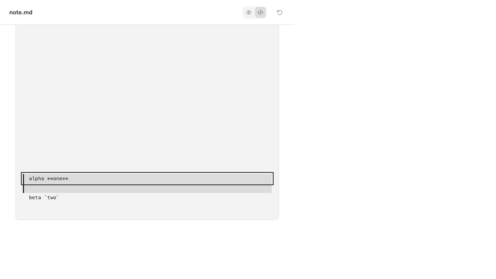

# BBP-249 verification

## Result and approved scope

Local package, browser and isolated build checks pass. Installed BB acceptance was not run because the task prohibits deployment and settings changes.

Koen explicitly approved an LF/CRLF-only layout guarantee after independent review. Lone CR remains exact in the source string but may collapse within a rendered group. A range request can split that group into more visible rows. No normalization, truncation or Raw UI redesign was added.

The Chromium reproduction contains 30,005 source lines in 30,045 UTF-8 bytes. Before the fix, Raw created 30,005 elements. After the fix, it creates 132 elements with the requested range active. Both runs compare Raw text with the complete source. These are DOM counts, not speed measurements.



The [structured browser result](raw-result.json) records exact source, element count, focus target and reader-local visibility.

Raw uses at most 128 base groups plus four boundary splits. The first requested line and the trailing empty line remain explicit targets. Selection citations use exact DOM text offsets and original newline sequences. Clearing a range transfers focus to Raw only when its focused target is removed. It does not reclaim focus from another control or scroll the page.

## Reproduce

Use Bun 1.4.3 and Node 24.15.0. Follow the [verification skill](../../.pi/skills/verify-bb-plugins/SKILL.md) for frozen setup and pinned Chromium.

```sh
.pi/skills/verify-bb-plugins/scripts/browser.sh markdown-reader /tmp/bbp-249-new-run raw-bounds.spec.ts
```

The first test fails on the pre-fix implementation at commit `fce9d51`:

```text
Expected: <= 132
Received:    30005
```

The final implementation passes the same assertion, exact-source comparison, inclusive highlights, repeated reveal, local visibility and clear-range focus checks. Two additional cases verify 302 LF and CRLF visual rows before, during and after a range split. Enter and Space cases use real caret-selection key events and preserve draft contents with zero sends.

## Executed checks

Evidence root is `/tmp/bbp-249-evidence`. Selected logs, JSON results, traces, screenshots, source hashes and the unchanged original review are attached to BBP-249 as `BBP-249-verification.zip`.

- Shared package tests pass all 132 cases. See `shared-final.log`.
- Reader tests pass all 238 cases. See `reader-final.log`.
- Tasks tests pass all 1,452 cases. See `tasks-approved.log`.
- Shared, Reader and Tasks typechecks exit 0. See `shared-types-final.log`, `reader-types-final.log` and `tasks-types-approved.log`.
- The complete Reader Chromium suite passes all 78 cases without retries. See `browser-approved-final/command.log` and `results.json`.
- The complete Tasks Chromium suite passes all 32 cases. See `tasks-approved-browser.log`.
- Consumer parity passes 4 Reader and 5 Tasks cases. See `parity-approved/reader.log` and `parity-approved/tasks.log`. Historical BBP-53 capture hashes remain unchanged.
- Fresh independent consumer builds pass all 19 setup, shared ESM, test, typecheck, pinned SDK and production-build commands. See `clean-build-approved/checks.json` and `inputs.json`.
- Root setup tests pass all 8 cases. Repository-wide lint and formatting pass. See `root-setup-tests.log`, `root-lint-approved.log` and `root-format-approved.log`.

Shared regressions cover 30,000 and 1,048,576 newline bytes, bounded DOM, large reversed ranges, exact highlighted text, trailing empty lines and focus on clear. A separate case verifies that clearing a range preserves external focus. Reader selection checks cover group boundaries, element endpoints, BOM, Unicode, LF, CRLF and lone-CR numerical provenance. Lone-CR visual row preservation is deliberately outside the approved guarantee.

The clean verifier uses separate disposable checkouts, removes the opposite consumer, clears ambient BB variables and uses private build data. Both bundles build without activating a plugin. Its Raw and selection source hashes match the final implementation:

```text
2b8e81b2265ccee3d75c19bafb896964c0f23dd4aef087930481c5c8ac615fda  packages/markdown-document/src/raw.tsx
280ed9c71a84b755abbcbabec940ebbac6a64a2e200c8d7526c1915111ab86e7  bb-plugin-markdown-reader/selection.tsx
```

## Independent review and closure

One fresh read-only Pi reviewer examined the complete change from baseline `e9afeecce2d0b4675f3879bd04d2a5cd40af30fa`. Its original verdict was request changes, with two reproduced findings. The original report remains unchanged in the evidence archive.

- P1 reported grouped lone-CR visual row collapse. Koen accepted this limitation and approved the LF/CRLF-only guarantee. Documentation now states it. LF and CRLF row geometry passes real-browser checks.
- P2 reported focus dropping to BODY when a request-only group disappears. A stable React ref cleanup now focuses Raw before removing its focused target. New shared and Chromium regressions failed before this fix and pass after it, including unchanged reader/page scroll and preservation of external focus.

The parent inspected the fix and reran affected checks. No second reviewer approval is claimed. Cursor-only helpers were unavailable and were not run.

## Retained failures and limits

The archive retains the original node-count failure, an intermediate trailing-empty-line failure, the initial focus-loss reproduction and their passing follow-ups. It also retains a NodeList test typecheck failure and a caret-test setup failure, both corrected without weakening assertions.

A later fixture timed out while selecting immediately after reveal. The test now waits for its focus target and two animation frames before selection. The final complete suite passes; the failed run remains in `scope-browser`. Production selection-dismissal behavior was not changed.

All browser contexts, listeners and caches belong to local fixture runners. The final Reader listener at port 59663 and its temporary cache were absent after teardown. Tasks port 4193 was also free after parity. Evidence remains available.

No installed plugin, production file, live draft, credential, secret or setting was read or changed. No deployment, activation or merge was attempted. Only task workflow metadata and verification attachments are intended tracker writes. No additional actionable cleanup defect was found in edited or adjacent code.

GitHub CLI is used because Origin and a built-in PR tool are unavailable. The PR remains open for human review.
